# Damez Loan: Loan Origination & Recovery Banking Suite

Production-grade lending platform for a Nigerian microfinance bank / digital lender. This repo holds **Phase 1 (Foundation)**; see [PLAN.md](PLAN.md) for the 5-phase roadmap and its **Handoff** section for the current state.

| | |
|---|---|
| Frontend | Next.js 15 (App Router), Tailwind + shadcn-style UI, Recharts, react-query |
| API | NestJS 11, Prisma 6, MySQL 8, Redis + BullMQ (Bull Board) |
| Shared | `packages/shared`: permission catalog, role seeds, zod schemas, DTO types, money/time/mask/redaction |

## Quick start (Docker)

```bash
docker compose up --build        # web :3000, api :4000, mysql :3306, redis :6379
```

The API container runs `prisma migrate deploy`, then the idempotent seed, then starts. Open <http://localhost:3000>.

### Demo logins

Password for every seeded user: `Damez@Demo2026`. 2FA is mandatory; with `DEMO_MODE=true` the login page shows a demo-account picker and a **Fill demo code** button (backed by `GET /api/v1/auth/demo-totp`, disabled when `DEMO_MODE=false` or `NODE_ENV=production`). Alternatively add the secret `JBSWY3DPEHPK3PXP` to any authenticator app, or run `npm run totp -w @damez/api`.

| Role | Email |
|---|---|
| Super Admin | admin@damez.ng |
| CEO / Executive | ceo@damez.ng |
| Credit Risk Manager | risk.manager@damez.ng |
| Credit Analyst | analyst@damez.ng |
| Loan Officer | officer@damez.ng (also officer.abuja@, officer.ph@) |
| Collections Manager | collections.manager@damez.ng |
| Collections Agent | agent@damez.ng |
| Finance / Treasury | treasury@damez.ng |
| Compliance / Audit | compliance@damez.ng |
| Customer Support | support@damez.ng |

`locked.officer@damez.ng` (locked) and `former.officer@damez.ng` (deactivated) demonstrate those states. A code can't be reused (replay protection): after logging out, wait for the next 30 s step to log in again as the same user.

### Try the maker-checker flow
1. Sign in as **officer@** → Approvals → *New request* → Waiver ₦400,000.
2. Sign in as **collections.manager@** (limit ₦250k) → approve → status becomes **Escalated**.
3. Sign in as **risk.manager@** (limit ₦500k) → approve → **Executed**. Audit Log shows each step; *Verify integrity* checks the hash chain.

## Local development (without Docker for the apps)

```bash
cp .env.example .env
docker compose up -d mysql redis
npm install
npm run build:shared
npm run db:generate && npm run db:migrate -w @damez/api -- --name init   # or: npm run db:deploy -w @damez/api
npm run db:seed
npm run dev                      # api :4000 + web :3000
```

Commands: `npm run lint | typecheck | test`, `npm run test:e2e -w @damez/api` (needs the seeded DB + Redis), `npm run e2e -w @damez/web` (Playwright; needs the stack running).

## What exists in Phase 1
- **Auth**: argon2id, mandatory TOTP, server-side sessions (idle 30 min / absolute 12 h), device & IP login events, lockout, replay-protected codes.
- **RBAC**: roles, 190+ `resource:action` permissions for every planned module, editable matrix (Super Admin locked), per-role approval limits, branch-scoped access.
- **Maker-checker**: generic registry + escalation above approver limit; sample actions: role change, product rate change (real), waiver / write-off / restructure / disbursement / loan approval (recorded, handlers arrive later).
- **Audit**: hash-chained append-only log + MySQL triggers, filter / CSV export / verify.
- **Notifications**: SMS, email, WhatsApp, in-app; templates, delivery logs; mock + live adapter stubs.
- **Security**: helmet, rate limits, CSRF, zod validation, idempotency keys, webhook signature helper, AES-256-GCM field encryption with key rotation, PII-redacting logger, consent model, DSR model.
- **Ops**: health (`/api/v1/health`, `/ready`), Bull Board (`/api/v1/admin/queues`, `system:jobs`), versioned migrations, [backup strategy](docs/BACKUP.md), CI.

## Architecture

```mermaid
graph TD
    Browser["Browser / Mobile\n(Next.js App Router)"]
    Web["Next.js 15\napps/web :3000"]
    API["NestJS 11 API\napps/api :4000"]
    MySQL["MySQL 8\n:3306"]
    Redis["Redis + BullMQ\n:6379"]

    Browser -->|"same-origin /api/*\n(sid+csrf cookies)"| Web
    Web -->|"HTTP proxy\n(API_INTERNAL_URL)"| API
    API --> MySQL
    API --> Redis

    subgraph "API modules"
        Auth["Auth\n(sessions, TOTP, lockout)"]
        RBAC["RBAC\n(roles, permissions, branch scope)"]
        Audit["Audit\n(hash-chained, append-only)"]
        Approvals["Approvals\n(maker-checker, escalation)"]
        Customers["Customers\n(PII encryption, DSR, consent)"]
        Bureau["Bureau\n(CRC / FirstCentral / CreditRegistry\nBureauAggregator)"]
        Apps["Applications\n(state machine, 16 states)"]
        Underwriting["Underwriting\n(queue, decision, SLA)"]
        Offers["Offers\n(amortization, PDF, e-sign, cooling-off)"]
        Disbursement["Disbursement\n(NIBSS NIP, reconciliation)"]
        Ledger["Ledger\n(double-entry, IFRS9/ECL)"]
        Collections["Collections\n(DPD buckets, PTP, agency)"]
        Behaviour["Behaviour\n(10 features, 5 segments, EWF)"]
        Customer360["Customer 360\n(aggregated view)"]
        PiiVault["PII Vault\n(tokenisation, detector, canary)"]
        LlmGW["LLM Gateway\n(PII scan barrier, consent check\nblock log, cost tracking)"]
        Supervisory["Supervisory\n(9 nightly snapshot jobs\nz-score anomaly detection)"]
        Executive["Executive\n(briefs, chat, approval inbox\n10 read-only tools)"]
    end

    API --- Auth
    API --- RBAC
    API --- Audit
    API --- Approvals
    API --- Customers
    API --- Bureau
    API --- Apps
    API --- Underwriting
    API --- Offers
    API --- Disbursement
    API --- Ledger
    API --- Collections
    API --- Behaviour
    API --- Customer360
    API --- PiiVault
    API --- LlmGW
    API --- Supervisory
    API --- Executive

    PiiVault -->|"blocks raw PII"| LlmGW
    LlmGW -->|"tokenised facts only\nno raw PII"| Anthropic["Anthropic API\n(claude-opus-5-5 / claude-haiku-5-5)"]

    subgraph "External providers"
        Dojah["Dojah\n(BVN / NIN / face KYC\nliveness, webhook)"]
        NIBSS["NIBSS\n(NIP disbursement\ne-mandate / GSI)"]
        Bureaus["CRC · FirstCentral\nCreditRegistry"]
        Notif["Termii / SMTP\n(SMS, email, WhatsApp)"]
        S3["S3-compatible\n(document storage)"]
    end

    API -->|"KYC_PROVIDER=dojah"| Dojah
    API -->|"PAYMENT_PROVIDER\nNIBSS_EMANDATE_PROVIDER\nGSI_PROVIDER"| NIBSS
    API -->|"CRC / FIRSTCENTRAL\nCREDITREGISTRY _PROVIDER"| Bureaus
    API -->|"SMS_PROVIDER\nEMAIL_PROVIDER\nWHATSAPP_PROVIDER"| Notif
    API -->|"STORAGE_PROVIDER=s3"| S3
```



> All provider slots have a **mock adapter** (default, works fully offline) and a **live stub** with `TODO(vendor)` markers. Switch by setting the corresponding `*_PROVIDER` env var; see `.env.example` and [GO_LIVE.md](GO_LIVE.md).

## Docs
[PLAN.md](PLAN.md) · [CLAUDE.md](CLAUDE.md) · [ASSUMPTIONS.md](ASSUMPTIONS.md) · [GO_LIVE.md](GO_LIVE.md) · [docs/BACKUP.md](docs/BACKUP.md) · [.env.example](.env.example)

## Phase 2: customer onboarding, KYC, credit bureau, applications, eligibility

**Customer portal** (mobile-first): <http://localhost:3000/portal/login>
- Demo customers (OTP is shown on screen in demo mode): **08030000001** (Adaeze Okafor, Tier 2, bureau consent given, ready to apply) and **08030000002** (Tunde Bakare, brand new: walk the onboarding wizard). Or register any new Nigerian number.
- Onboarding wizard: email verify → profile → BVN → NIN → face KYC (Dojah widget; mock camera flow in demo) → bank account name enquiry → documents → bureau consent. Progress tracker + KYC tier (T1 ₦100k / T2 ₦1M / T3 ₦10M loan cap).
- Apply: pick a product, see the repayment schedule + total cost of credit (EIR), **check eligibility** (needs bureau consent) → friendly reasons, concrete suggestions (reduce amount, longer tenor, guarantor, link accounts, reapply after N days) and alternative offers → submit → status tracking.

**Mock KYC / bureau scenarios** (deterministic offline). For a BVN or NIN `…TU`: last digit **U** picks the KYC outcome (0 pass · 1 name mismatch · 2 not found · 3 low-confidence face · 4 liveness fail · 5 PEP match · 9 phone mismatch) and tens digit **T** picks the credit-bureau profile (0/1/8 clean · 2 thin file · 3/9 late payer · 4 serial defaulter · 5 written-off · 6 over-indebted · 7 fraud-flagged). E.g. `22000000000` pass + clean; `22000000050` pass + written-off (auto-declined); `22000000060` pass + over-indebted. Face KYC demo scenarios are selectable in the widget.

**Staff console additions**: Customers (360° record: KYC timeline, documents with audited download + review, consents, screening, fraud signals, **Credit Bureau Report** tab), Applications (state machine view, eligibility explainer, bureau summary), Credit Bureau (usage & spend, pull log, furnishing, monitoring, score distribution), Loan Products (pricing edits go through maker-checker), Scorecards (versioned editor, activation approval, what-if simulator). Try as `risk.manager@damez.ng`.

**Switching to real providers**: set `KYC_PROVIDER=dojah` + `DOJAH_*`, `CRC_PROVIDER=live` + `CRC_*` (same for `FIRSTCENTRAL_*`, `CREDITREGISTRY_*`), `STORAGE_PROVIDER=s3` + `S3_*`, `VIRUS_SCAN_PROVIDER=clamav`. Live adapters are structural with `TODO(...)` markers: see ASSUMPTIONS.md. Dojah webhook URL: `POST /api/v1/webhooks/dojah` (HMAC-SHA256 hex in `x-dojah-signature`).
